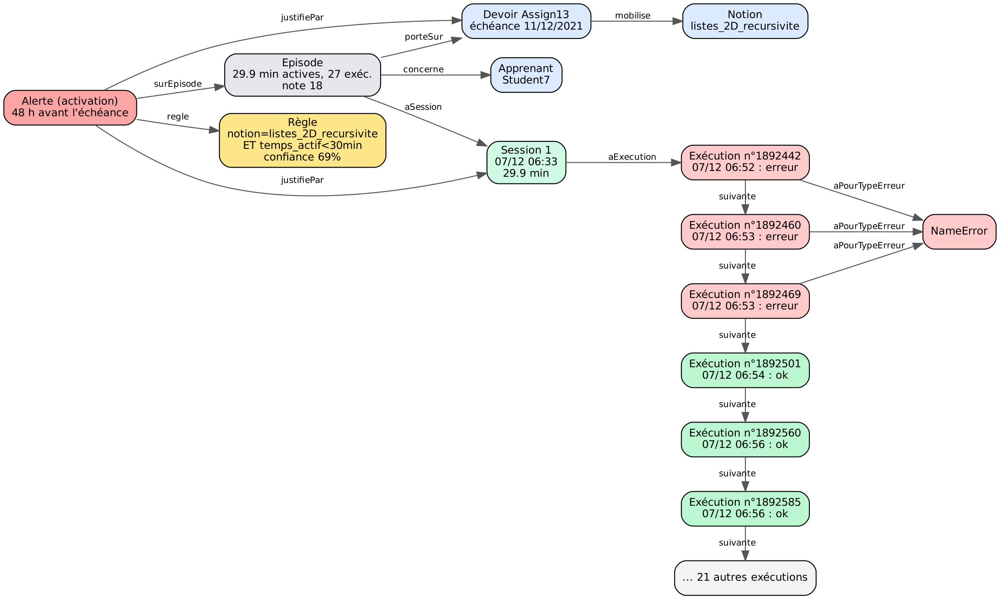

# Des traces aux explications : graphe de connaissances et règles interprétables pour des learning analytics justifiables

Prototype de recherche d'**Amal Beldi**, préparé pour un séminaire de l'équipe NOCE (CRIStAL, Université de Lille).

**Question.** Peut-on repérer, 48 h avant l'échéance, un étudiant en difficulté sur un devoir de programmation, et justifier l'alerte par ses traces ?

**Approche.** Les traces ProgSnap2 sont structurées dans un graphe de connaissances RDF. On en extrait des règles lisibles, comparées à un modèle opaque, puis chaque alerte est expliquée par le sous-graphe des sessions et exécutions qui la fondent.



## Résultats principaux

Ces résultats sont exploratoires et portent sur 262 épisodes (étudiant × devoir).

| Résultat | Valeur |
| --- | --- |
| Taux de difficulté (note du devoir < 70) | 21 % |
| Pas commencé 48 h avant l'échéance | 33 % en difficulté, contre 13 % pour ceux qui ont commencé |
| Meilleure règle : listes 2D et récursivité ET moins de 10 exécutions | 69 % en difficulté (11 sur 16) |
| Règles contre forêt aléatoire (validation croisée groupée par étudiant) | AUC 0,69 contre 0,71 ; 73 alertes contre 130 ; 42 % d'alertes justes contre 32 % |
| Alertes finales | 66 épisodes, dont 33 réellement en difficulté |

48 h avant l'échéance, ce qui annonce la difficulté est le **manque d'engagement**, pas les erreurs : les étudiants qui réussissent exécutent leur code plus souvent, et font donc plus d'erreurs. Relier les traces à la **notion** du devoir rend les règles nettement plus précises.

Le détail se trouve dans [`resultats_exemple/`](resultats_exemple/) : règles, comparaison des modèles, sortie des requêtes SPARQL, explications générées.

## Données

*CS1 Keystroke Data 2021*, Utah State University : 44 étudiants débutants, 8 devoirs Python, 2,1 millions d'événements au format ProgSnap2, avec la note de chaque devoir.

- Jeu de données : https://doi.org/10.7910/DVN/BVOF7S (Harvard Dataverse)
- Article : Edwards, J., Hart, K., & Shrestha, R. (2023). *Review of CSEDM Data and Introduction of Two Public CS1 Keystroke Datasets*. Journal of Educational Data Mining, 15(1), 1–31.

Les données ne sont pas redistribuées ici. Téléchargez `dataverse_files.zip` depuis Dataverse et placez-le, sans le décompresser, dans `donnees/keystroke2021/`. L'étape 1 lit `runs1.csv` et `runs2.csv` (2,4 Go) directement dans le zip et en extrait `keystrokes.csv`, `students.csv` et `due.csv`.

## Installation

```bash
pip install -r requirements.txt
```

## Les 5 étapes

| Étape | Commande | Produit | Durée |
| --- | --- | --- | --- |
| 1. Résumer les exécutions | `python etape1_resumer_executions.py runs1.csv runs2.csv --zip donnees/keystroke2021/dataverse_files.zip --sortie donnees/keystroke2021/executions.csv` | une ligne par exécution, avec son type d'erreur | ~2 min |
| 2. Indicateurs par épisode | `python etape2_indicateurs.py --donnees donnees/keystroke2021 --sortie resultats` | `episodes.csv`, `executions_detaillees.csv` | ~10 s |
| 3a. Construire le graphe | `python etape3_graphe.py --donnees donnees/keystroke2021 --resultats resultats --notions notions.csv` | `graphe.ttl` (~265 000 triplets) | ~25 s |
| 3b. Interroger le graphe | `python etape3_requetes.py --graphe resultats/graphe.ttl` | 4 requêtes SPARQL commentées | ~20 s |
| 4. Règles et comparaison | `python etape4_regles.py --resultats resultats --notions notions.csv` | `regles.md`, `comparaison.csv`, `graphe_avec_regles.ttl` | ~30 s |
| 5. Explications et figure | `python etape5_explications.py --resultats resultats` | `explications.md`, `explications.csv`, figure du sous-graphe | ~25 s |

La figure de l'étape 5 demande [Graphviz](https://graphviz.org). Sans lui, le script écrit le fichier `.dot`, que l'on peut visualiser en ligne.

## Démonstration

Une fois le graphe produit (étapes 1 à 4), une seule commande interroge le graphe en SPARQL et explique une alerte :

```bash
python demo.py                 # Student7, devoir Assign13
python demo.py --pas-a-pas     # Entrée entre chaque étape, pour une présentation
python demo.py --lister        # les 66 alertes, justifiées ou non
python demo.py --seminaire     # les 3 cas du séminaire à la suite (ou double-clic sur demo_seminaire.bat)
python demo.py --apprenant Student1 --devoir Assign13   # une fausse alerte
```

Sous Windows (PowerShell), depuis le dossier du dépôt :

```powershell
py -m pip install -r requirements.txt
mkdir donnees\keystroke2021      # puis y copier dataverse_files.zip
py etape1_resumer_executions.py runs1.csv runs2.csv --zip donnees\keystroke2021\dataverse_files.zip --sortie donnees\keystroke2021\executions.csv
py etape2_indicateurs.py --donnees donnees\keystroke2021 --sortie resultats
py etape3_graphe.py --donnees donnees\keystroke2021 --resultats resultats --notions notions.csv
py etape4_regles.py --resultats resultats --notions notions.csv
py demo.py --pas-a-pas
```

### Les trois cas du mode séminaire

| 48 h avant l'échéance | Student7 · Assign13 | Student22 · Assign12 | Student1 · Assign13 |
| --- | --- | --- | --- |
| Notion | listes 2D et récursivité | recherche et tri | listes 2D et récursivité |
| Sessions, temps actif | 1, 29,9 min | 1, 35,4 min | 0, 0 min |
| Exécutions (en erreur) | 27 (3 NameError) | 26 (8 : ValueError, SyntaxError, TypeError) | 0 |
| Règle la plus forte | notion ET temps actif < 30 min | notion ET une seule session | moins de 10 exécutions ET notion |
| Confiance, lift | 69 %, 3,2 | 39 %, 1,8 | 69 %, 3,2 |
| Après l'alerte (non utilisé) | 16 min, 9 exécutions | rien | 113 min, 28 exécutions, dans les 13 dernières heures |
| Note | 18 : alerte justifiée | 21 : alerte justifiée | 86 : fausse alerte |

Student1 n'a pas travaillé hors de l'outil : il a tout fait dans l'outil, mais après l'alerte. Une alerte unique à 48 h ne peut pas voir ce profil.

**Taux de base.** 56 épisodes sur 262 ont une note inférieure à 70, soit 21 %. La confiance d'une règle se compare à ce taux ; le lift est le rapport des deux (69 % ÷ 21 % ≈ 3,2).

## Ontologie

[`ontologie/ontologie_v03.ttl`](ontologie/ontologie_v03.ttl) est organisée en trois niveaux :

- **contexte** : Apprenant, Devoir, Notion ;
- **activité** : Épisode, Session, Exécution, TypeErreur, avec `lt:suivante` pour l'ordre temporel et `lt:avantAlerte` pour la frontière de prédiction ;
- **interprétation** : indicateurs, Règle, Activation, avec `lt:justifiePar` vers les preuves.

## Choix méthodologiques

- **Difficulté** : note du devoir inférieure à 70.
- **Moment de l'alerte** : 48 h avant l'échéance. Seuls les événements antérieurs servent aux indicateurs, ce qui évite toute fuite d'information venue après coup.
- **Session** : suite d'événements sans pause de plus de 30 min ; **temps actif** : somme des écarts de moins de 5 min.
- **Règles** : combinaisons de 1 à 3 conditions lisibles, support ≥ 5 %, lift ≥ 1,3, doublons éliminés.
- **Évaluation** : validation croisée en 5 plis, groupée par étudiant, contre un arbre court, une régression logistique et une forêt aléatoire.
- **Notions** ([`notions.csv`](notions.csv)) : la notion principale de chaque devoir, d'après les objectifs de son sujet.

Ces paramètres se trouvent en haut des scripts et se modifient en une ligne.

## Limites

- 44 étudiants et un seul cours : il faut reproduire l'analyse sur d'autres cohortes.
- Il s'agit de corrélations, pas de causalités : une alerte signale un risque, elle n'en explique pas la cause.
- Les seuils et les notions sont fixés à la main et doivent être validés avec des enseignants.
- L'utilité des explications pour les enseignants n'a pas encore été mesurée.
- Un étudiant qui travaille hors de l'environnement instrumenté apparaît comme inactif.

## Licence

Code sous licence MIT. Les données restent soumises aux conditions de leur dépôt d'origine.
